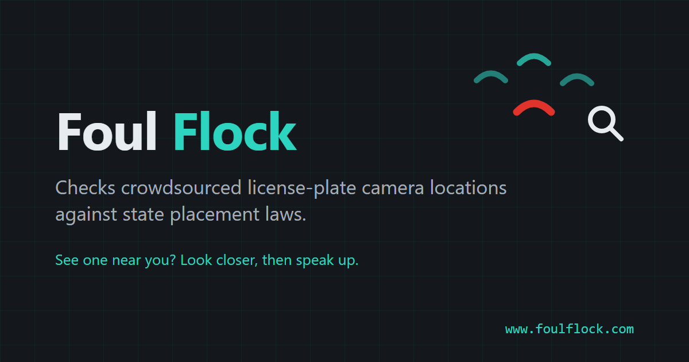
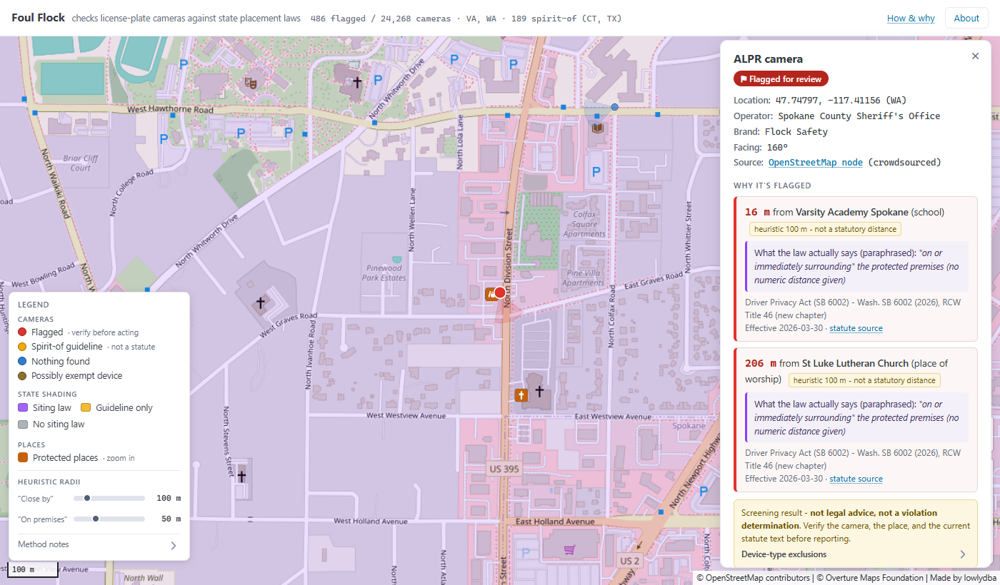

# Foul Flock

Find license-plate cameras that may sit where state law says they shouldn't.

[Open the map at www.foulflock.com](https://www.foulflock.com)

Automated license plate readers (ALPRs) photograph every passing car and log where it was. A few states have decided these cameras don't belong near schools, places of worship, clinics, and similar places. Those laws only matter if someone checks, and checking by hand means reading statutes and measuring distances one camera at a time.

Foul Flock does the measuring. It cross-references crowdsourced camera locations against a hand-curated table of state camera-siting laws and flags every camera close enough to a protected place to deserve a second look.

## Using the map

Zoom into a purple state. Red dots are cameras near a school, place of worship, healthcare facility, court, or food bank. Click one to see the distance, the statute citation, and the law's placement language quoted word for word.

Some laws say "immediately surrounding" instead of giving a number. For those, two sliders in the legend set what counts as close, and results that rely on them are labeled.

"Draft report" turns a flag into a starting-point records or relocation request, which you fill in with facts you've checked yourself. If a camera is in the wrong spot, its detail panel links to the OpenStreetMap node so you can fix it there.

## What's on the map

| Color | Meaning |
|---|---|
| Red camera | Within the screened distance of a protected place, in a state with a siting law |
| Blue camera | Checked against a siting law, nothing mapped nearby (hidden until you turn on "Cameras with nothing found") |
| Amber camera | Matches a spirit-of guideline, not a statute; never produces a report letter |
| Purple state | Has an ALPR siting statute |
| Amber state | No siting statute, but an executive action or not-yet-operative provision in the same spirit |
| Grey state | Reviewed, no siting law |
| No shading | Not reviewed, so no claim either way |

Siting statutes currently on the map are Washington's Driver Privacy Act and Virginia's HB 2724. Florida, Texas, and Connecticut show as amber guidelines. Every other state and DC has been reviewed and has no siting law; the per-state notes and sources live in [rules/alpr_state_rules.yaml](rules/alpr_state_rules.yaml).

## Read before acting on anything here

> [!IMPORTANT]
> Foul Flock is a screening tool for advocacy and compliance research. It isn't legal advice, a router, or a camera-avoidance app.

- A flag is a candidate for human verification, never a violation determination. Verify the camera, the place, and the current statute text before contacting any agency.
- Camera positions are crowdsourced and can be wrong, stale, or mis-tagged. Place data has the same problem.
- Some distances are ours, not the law's. When a statute gives no number, the map uses an adjustable radius and labels it everywhere it appears.
- Siting-specific ALPR laws are rare. Most state ALPR statutes govern data retention and access, not placement.

## How it works

A Python build pulls ALPR cameras from OpenStreetMap (the [DeFlock](https://deflock.me) tagging convention) and protected places and state boundaries from Overture Maps, matches them against the rules file, and writes static GeoJSON and map tiles. The site is plain [MapLibre](https://maplibre.org) on GitHub Pages: no backend, no runtime API calls, no tracking. A scheduled workflow refreshes cameras weekly and Overture data monthly.

Big thanks to [PMTiles](https://github.com/protomaps/PMTiles) from Protomaps. States, protected places, and the tens of thousands of cameras with nothing nearby each ship as a single PMTiles archive, and the browser fetches only the tiles in view by HTTP range request, so a nationwide map runs off static hosting with no tile server.

## Docs

- [How the map works](docs/how-it-works.md): statuses, heuristic distances, view cones, data sources
- [Development](docs/development.md): repo layout, building, testing, CI
- [Maintaining the rules file](docs/rules-file.md): how laws get added and re-reviewed
- [AGENTS.md](AGENTS.md): the full maintenance runbook and rules-file schema

Found a wrong place or a missing law? [Open an issue](https://github.com/lowlydba/foul-flock/issues) with a link to the statute or the place.

## License

Code is [MIT](LICENSE). The data is not:

- Cameras, and state boundaries via Overture divisions, are OSM-derived and remain under [ODbL 1.0](https://opendatacommons.org/licenses/odbl/) © OpenStreetMap contributors.
- Overture places remain under [CDLA-Permissive-2.0](https://cdla.dev/permissive-2-0/) © Overture Maps Foundation.
- The vendored Overture taxonomy in `build/vendor/` is CC-BY-4.0.

The build stamps a `DATA_LICENSE.txt` into `web/data/` alongside the artifacts. Keep those notices intact when redistributing.

Made by [lowlydba](https://github.com/lowlydba).
